# Claude Code Desktop Mods

Bộ 30 giao diện có hình nền chuyển động dành cho Claude Code trên ứng dụng Claude Desktop. Mỗi giao diện gồm một bảng màu đầy đủ cho cả chế độ sáng và chế độ tối, cùng một cảnh nền vector chuyển động nhẹ với họa tiết riêng: không có hai giao diện nào dùng chung họa tiết hay nền.

Các giao diện chia thành bốn nhóm: **Sang trọng**, **Chuyên nghiệp**, **Dễ thương** và **Thiên nhiên**. Danh sách đầy đủ kèm ảnh xem trước nằm ở cuối trang.

**Xem thử và sao chép lệnh cài tại trang giới thiệu: https://andyluu93.github.io/claude-code-desktop-mods/**

## Yêu cầu

- Ứng dụng Claude Desktop, sử dụng thẻ **Code** (Claude Code), phiên bản có hỗ trợ plugin giao diện.
- Lệnh `claude` (Claude Code CLI) để cài đặt. Trường hợp máy chưa có lệnh này, có thể nhờ chính Claude Code trong ứng dụng thực hiện theo hướng dẫn bên dưới.

## Cài đặt

### Cách 1: Nhờ Claude Code cài đặt

Mở một phiên mới trong thẻ Code, dán nội dung sau và thay `<mã>` bằng mã giao diện muốn dùng (xem danh sách bên dưới):

```text
Hãy cài giao diện cho Claude Code từ kho https://github.com/andyluu93/claude-code-desktop-mods.
Chỉ chạy đúng hai lệnh sau, không chạy lệnh nào khác:
claude plugin marketplace add andyluu93/claude-code-desktop-mods
claude plugin install <mã>@cc-desktop-mods
Chạy xong thì báo kết quả.
```

Sau khi cài xong, mở một phiên mới để giao diện được áp dụng.

### Cách 2: Cài bằng dòng lệnh

Thêm kho giao diện (chỉ cần làm một lần):

```bash
claude plugin marketplace add andyluu93/claude-code-desktop-mods
```

Cài giao diện theo mã, ví dụ giao diện Hồ sen:

```bash
claude plugin install ho-sen@cc-desktop-mods
```

Mở một phiên mới trong thẻ Code để thấy giao diện.

## Đổi giao diện

Mỗi giao diện đang bật sẽ tự áp dụng khi mở phiên mới. Nên chỉ để **một** giao diện ở trạng thái bật để tránh các giao diện ghi đè lẫn nhau.

Tắt giao diện đang dùng và bật giao diện khác:

```bash
claude plugin disable ho-sen@cc-desktop-mods
```

```bash
claude plugin enable thien-ha@cc-desktop-mods
```

Trong một phiên đang mở, có thể chuyển nhanh giữa các giao diện đã bật bằng cách gõ vào ô chat cụm từ `giao diện` kèm tên giao diện, ví dụ `giao diện hồ sen` hoặc `giao dien thien ha`. Cụm từ này chỉ dùng để đổi giao diện và không được gửi tới mô hình.

## Cập nhật và gỡ cài đặt

Cập nhật kho để nhận giao diện mới hoặc bản sửa lỗi:

```bash
claude plugin marketplace update cc-desktop-mods
```

Gỡ một giao diện:

```bash
claude plugin uninstall ho-sen@cc-desktop-mods
```

Gỡ toàn bộ kho giao diện:

```bash
claude plugin marketplace remove cc-desktop-mods
```

## Khắc phục sự cố

| Hiện tượng | Cách xử lý |
|---|---|
| Không thấy hình nền sau khi cài | Mở một phiên mới. Kiểm tra giao diện đang ở trạng thái bật bằng lệnh `claude plugin list`. Trong phiên đang mở có thể gõ `/reload-plugins`. |
| Giao diện hiển thị không đúng giao diện vừa chọn | Đang có nhiều giao diện cùng bật. Tắt các giao diện không dùng bằng `claude plugin disable`. |
| Gõ `giao diện ...` nhưng không đổi | Giao diện đó chưa được cài hoặc đang tắt. Cụm từ chỉ hoạt động với giao diện đã bật. |
| Chữ khó đọc trên nền | Mỗi giao diện được thiết kế cho một chế độ (sáng hoặc tối, ghi trong danh sách). Chuyển ứng dụng sang đúng chế độ đó để có độ tương phản tốt nhất. |

## An toàn và quyền riêng tư

- Mỗi giao diện chỉ đổi bảng màu và vẽ hình nền. Mã không đọc tệp, không chạy lệnh và không gửi dữ liệu ra ngoài.
- Hình nền là mã SVG nằm sẵn trong plugin, không tải hình ảnh hay tài nguyên từ Internet. Ứng dụng hiển thị hình nền trong một khung cách ly có bộ lọc nội dung.
- Mã nguồn của từng giao diện nằm tại `mods/<mã>/hooks/register.tsx` để người dùng tự kiểm tra trước khi cài.

## Tự tạo giao diện mới

Quy trình thiết kế, các quy tắc để hình nền chuyển động ổn định trong ứng dụng và cách đóng gói được trình bày tại [docs/quy-trinh-tao-mod.md](docs/quy-trinh-tao-mod.md). Toàn bộ 30 giao diện được sinh từ `tools/themes.mjs` bằng lệnh:

```bash
node tools/build.mjs andyluu93
```

Trang xem trước tất cả hình nền nằm tại `preview/index.html` (mở bằng trình duyệt sau khi tải kho về máy).

## Danh sách giao diện

<!-- LIST:START -->
### Sang trọng

| Xem trước | Tên và mã cài đặt | Mô tả |
|---|---|---|
|  | **Hoàng kim Art Deco**<br>`hoang-kim-art-deco`<br>Hợp chế độ tối | Sảnh Art Deco đen vàng: cột bậc thang hai bên, các chùm đèn vàng hắt lên nhấp nháy chậm. |
|  | **Ngọc lục bảo**<br>`ngoc-luc-bao`<br>Hợp chế độ tối | Nền khảm đa giác xanh ngọc, bốn viên ngọc lục bảo viền vàng nghiêng nhẹ và lóe sáng. |
|  | **Rượu vang nhung**<br>`ruou-vang-nhung`<br>Hợp chế độ tối | Sân khấu rèm nhung đỏ rượu vang lay nhẹ, tua vàng hồng đung đưa, đèn sân khấu ấm. |
|  | **Đêm sapphire**<br>`dem-sapphire`<br>Hợp chế độ tối | Trăng bạc trên mặt biển xanh sapphire, vệt sáng lấp lánh trên sóng, sóng ngầm trôi chậm. |
|  | **Đá cẩm thạch đen**<br>`da-cam-thach-den`<br>Hợp chế độ tối | Cẩm thạch đen vân xám, các vết nứt hàn vàng kiểu kintsugi, ánh vàng chạy dọc vết nứt. |
|  | **Ngọc trai**<br>`ngoc-trai`<br>Hợp chế độ sáng | Lụa ngà uốn lượn trôi chậm, ba chuỗi ngọc trai treo đung đưa trên nền sâm panh. |
|  | **Nâu đất kim**<br>`nau-dat-kim`<br>Hợp chế độ tối | Nâu đất ấm và vàng kim, hoa văn gấm, hai vòng hoa văn xoay, bụi vàng bay lên. |
|  | **Tím hoàng gia**<br>`tim-hoang-gia`<br>Hợp chế độ tối | Hai quạt lông công vươn lên từ hai góc dưới, mắt lông xanh vàng đung đưa trên nền tím. |

### Chuyên nghiệp

| Xem trước | Tên và mã cài đặt | Mô tả |
|---|---|---|
|  | **Xanh doanh nghiệp**<br>`xanh-doanh-nghiep`<br>Hợp chế độ tối | Biểu đồ tăng trưởng tự vẽ dần ở hai góc dưới, vòng tròn chỉ tiêu tăng giảm, nền navy. |
|  | **Than chì tối giản**<br>`than-chi-toi-gian`<br>Hợp chế độ tối | Hình khối Bauhaus mảnh trôi chậm, kim đồng hồ quay một vòng mỗi phút, điểm xanh ngọc. |
|  | **Bản vẽ kỹ thuật**<br>`ban-ve-ky-thuat`<br>Hợp chế độ tối | Giấy bản vẽ xanh có lưới, bốn bánh răng quay ăn khớp, đường kích thước nét đứt. |
|  | **Dòng dữ liệu**<br>`dong-du-lieu`<br>Hợp chế độ tối | Mưa dữ liệu xanh lam rơi dọc màn hình, các nút mạng phát sóng ở hai góc. |
|  | **Kết nối toàn cầu**<br>`ket-noi-toan-cau`<br>Hợp chế độ tối | Quả địa cầu kinh tuyến xoay, vệ tinh vàng bay quanh quỹ đạo nghiêng. |
|  | **Giấy trắng**<br>`giay-trang`<br>Hợp chế độ sáng | Trang giấy kẻ dòng có lề đỏ, máy bay giấy bay chéo lên kèm vệt nét đứt. |
|  | **Xanh sage thanh lịch**<br>`xanh-sage`<br>Hợp chế độ sáng | Những nhành bạch đàn treo từ mép trên, lá tròn xanh sage đung đưa nhẹ. |
|  | **Đêm thành phố**<br>`dem-thanh-pho`<br>Hợp chế độ tối | Ba cột đèn pha quét bầu trời tím, đường chân trời thành phố với cửa sổ sáng tắt. |

### Dễ thương

| Xem trước | Tên và mã cài đặt | Mô tả |
|---|---|---|
|  | **Kẹo ngọt**<br>`keo-ngot`<br>Hợp chế độ sáng | Kẹo mút xoắn xoay tròn ở các góc, kẹo bọc giấy nhiều màu nhún nhảy. |
|  | **Hoa anh đào**<br>`hoa-anh-dao`<br>Hợp chế độ sáng | Cành anh đào nở hoa ở hai góc, cánh hoa hồng rơi xoay trong gió. |
|  | **Mây bông**<br>`may-bong`<br>Hợp chế độ sáng | Trời xanh pastel, mây bông trôi chậm, đàn chim nhỏ vỗ cánh bay ngang. |
|  | **Sao đêm pastel**<br>`sao-dem-pastel`<br>Hợp chế độ tối | Ngôi sao và hành tinh treo trên sợi chỉ, đung đưa như đồ chơi nôi trên nền tím đêm. |
|  | **Biển xanh**<br>`bien-xanh`<br>Hợp chế độ sáng | Sóng biển nhiều lớp, đàn cá nhỏ quẫy đuôi bơi ngang, bong bóng nước bay lên. |
|  | **Bóng bay**<br>`bong-bay`<br>Hợp chế độ sáng | Nền kem ấm, bóng bay nhiều màu bay lên đung đưa, giấy kim tuyến rơi. |
|  | **Vườn hoa**<br>`vuon-hoa`<br>Hợp chế độ sáng | Hoa nhỏ đung đưa dưới đáy, bướm nhiều màu vỗ cánh bay lượn trên nền bạc hà. |

### Thiên nhiên

| Xem trước | Tên và mã cài đặt | Mô tả |
|---|---|---|
|  | **Hồ sen**<br>`ho-sen`<br>Hợp chế độ tối | Nhìn từ trên xuống mặt hồ: lá sen, hoa sen hồng, cá koi bơi vòng, gợn nước lan tỏa. |
|  | **Rừng tre**<br>`rung-tre`<br>Hợp chế độ tối | Rừng tre đêm xanh thẫm, thân tre đung đưa hai bên, đom đóm lập lòe. |
|  | **Cực quang**<br>`cuc-quang`<br>Hợp chế độ tối | Dải cực quang xanh tím uốn lượn trên bầu trời đêm phương Bắc, dãy núi tối. |
|  | **Thiên hà**<br>`thien-ha`<br>Hợp chế độ tối | Thiên hà xoắn ốc xoay chậm, tinh vân tím hồng, sao băng vụt qua. |
|  | **Hoàng hôn sa mạc**<br>`hoang-hon-sa-mac`<br>Hợp chế độ tối | Mặt trời lặn trên đồi cát, đoàn lạc đà đi chậm qua đường chân trời, cát bay theo gió. |
|  | **Mùa thu**<br>`mua-thu`<br>Hợp chế độ sáng | Những luồng gió thu vẽ thành vệt cam, lá phong đỏ cam rơi xoay theo gió. |
|  | **Đông tuyết**<br>`dong-tuyet`<br>Hợp chế độ tối | Rừng thông phủ tuyết hai lớp, tuyết rơi xoay nhẹ trên nền đêm đông xanh lạnh. |
<!-- LIST:END -->

## Giấy phép

Phát hành theo giấy phép MIT. Xem tệp [LICENSE](LICENSE).
