# Claude Code Desktop Mods

Bộ 30 giao diện có hình nền chuyển động dành cho Claude Code trên ứng dụng Claude Desktop. Mỗi giao diện gồm một bảng màu và một cảnh nền vector chuyển động nhẹ với họa tiết riêng: không có hai giao diện nào dùng chung họa tiết hay nền. Giao diện tự sáng hoặc tối theo cài đặt giao diện của ứng dụng, cả màu nền lẫn màu chữ, nên không cần chọn bản riêng cho từng chế độ.

Các giao diện chia thành bốn nhóm: **Sang trọng**, **Chuyên nghiệp**, **Dễ thương** và **Thiên nhiên**. Danh sách đầy đủ kèm ảnh xem trước nằm ở cuối trang.

**Xem thử và sao chép lệnh cài tại trang giới thiệu: https://andyluu93.github.io/claude-code-desktop-mods/**

## Yêu cầu

- Ứng dụng Claude Desktop, sử dụng thẻ **Code** (Claude Code), phiên bản có hỗ trợ plugin giao diện.
- Lệnh `claude` (Claude Code CLI) để cài đặt. Trường hợp máy chưa có lệnh này, có thể nhờ chính Claude Code trong ứng dụng thực hiện theo hướng dẫn bên dưới.

## Cài đặt

### Cách 1: Nhờ Claude Code cài đặt

Mở một phiên mới trong thẻ Code, dán nội dung sau và thay `<mã>` bằng mã giao diện muốn dùng (xem danh sách bên dưới):

```text
Hãy cài giao diện cho Claude Code từ kho https://github.com/andyluu93/claude-code-desktop-mods.
Chỉ chạy đúng hai lệnh sau, không chạy lệnh nào khác:
claude plugin marketplace add andyluu93/claude-code-desktop-mods
claude plugin install <mã>@cc-desktop-mods
Chạy xong thì báo kết quả.
```

Sau khi cài xong, mở một phiên mới để giao diện được áp dụng.

### Cách 2: Cài bằng dòng lệnh

Thêm kho giao diện (chỉ cần làm một lần):

```bash
claude plugin marketplace add andyluu93/claude-code-desktop-mods
```

Cài giao diện theo mã, ví dụ giao diện Hồ sen:

```bash
claude plugin install ho-sen@cc-desktop-mods
```

Mở một phiên mới trong thẻ Code để thấy giao diện.

## Đổi giao diện

Gõ vào ô chat cụm từ `giao diện` kèm tên giao diện, ví dụ `giao diện hồ sen` hoặc `giao dien thien ha`. Cụm từ này chỉ dùng để đổi giao diện và không được gửi tới mô hình.

Lựa chọn được ghi nhớ: các phiên mới sau đó tự mở đúng giao diện vừa chọn, kể cả khi máy đã cài nhiều giao diện. Giao diện vừa cài thêm sẽ tự bật ở phiên mới đầu tiên sau khi cài.

Lệnh và cụm từ của một giao diện mới cài chỉ có hiệu lực từ phiên mới; trong phiên đã mở trước khi cài, lệnh `/reload-plugins` không bổ sung được các lệnh này.

## Cập nhật và gỡ cài đặt

Cập nhật kho để nhận giao diện mới hoặc bản sửa lỗi:

```bash
claude plugin marketplace update cc-desktop-mods
```

Gỡ một giao diện:

```bash
claude plugin uninstall ho-sen@cc-desktop-mods
```

Gỡ toàn bộ kho giao diện:

```bash
claude plugin marketplace remove cc-desktop-mods
```

## Khắc phục sự cố

| Hiện tượng | Cách xử lý |
|---|---|
| Không thấy hình nền sau khi cài | Mở một phiên mới. Kiểm tra giao diện đang ở trạng thái bật bằng lệnh `claude plugin list`. |
| Phiên mới mở giao diện khác với mong muốn | Gõ `giao diện <tên>` một lần; lựa chọn được ghi nhớ cho các phiên sau. |
| Gõ `giao diện ...` nhưng không đổi | Giao diện đó chưa được cài, đang tắt, hoặc phiên được mở trước khi cài. Mở một phiên mới rồi gõ lại. |

## An toàn và quyền riêng tư

- Mỗi giao diện chỉ đổi bảng màu và vẽ hình nền. Mã không đọc tệp, không chạy lệnh và không gửi dữ liệu ra ngoài; dữ liệu duy nhất được lưu là trạng thái giao diện đang chọn, trong vùng lưu trữ riêng của plugin trên máy.
- Hình nền là mã SVG nằm sẵn trong plugin, không tải hình ảnh hay tài nguyên từ Internet. Ứng dụng hiển thị hình nền trong một khung cách ly có bộ lọc nội dung.
- Mã nguồn của từng giao diện nằm tại `mods/<mã>/hooks/register.tsx` để người dùng tự kiểm tra trước khi cài.

## Tự tạo giao diện mới

Quy trình thiết kế, các quy tắc để hình nền chuyển động ổn định trong ứng dụng và cách đóng gói được trình bày tại [docs/quy-trinh-tao-mod.md](docs/quy-trinh-tao-mod.md). Toàn bộ 30 giao diện được sinh từ `tools/themes.mjs` bằng lệnh:

```bash
node tools/build.mjs andyluu93
```

Trang xem trước tất cả hình nền ở cả hai chế độ nằm tại `preview/index.html` (mở bằng trình duyệt sau khi tải kho về máy).

## Danh sách giao diện

<!-- LIST:START -->
### Sang trọng

| Xem trước (sáng, tối) | Tên và mã cài đặt | Mô tả |
|---|---|---|
|  | **Hoàng kim Art Deco**<br>`hoang-kim-art-deco` | Sảnh Art Deco đen vàng: cột bậc thang hai bên, các chùm đèn vàng hắt lên nhấp nháy chậm. |
|  | **Ngọc lục bảo**<br>`ngoc-luc-bao` | Nền khảm đa giác xanh ngọc, bốn viên ngọc lục bảo viền vàng nghiêng nhẹ và lóe sáng. |
|  | **Rượu vang nhung**<br>`ruou-vang-nhung` | Sân khấu rèm nhung đỏ rượu vang lay nhẹ, tua vàng hồng đung đưa, đèn sân khấu ấm. |
|  | **Đêm sapphire**<br>`dem-sapphire` | Trăng bạc trên mặt biển xanh sapphire, vệt sáng lấp lánh trên sóng, sóng ngầm trôi chậm. |
|  | **Đá cẩm thạch đen**<br>`da-cam-thach-den` | Cẩm thạch đen vân xám, các vết nứt hàn vàng kiểu kintsugi, ánh vàng chạy dọc vết nứt. |
|  | **Ngọc trai**<br>`ngoc-trai` | Lụa ngà uốn lượn trôi chậm, ba chuỗi ngọc trai treo đung đưa trên nền sâm panh. |
|  | **Nâu đất kim**<br>`nau-dat-kim` | Nâu đất ấm và vàng kim, hoa văn gấm, hai vòng hoa văn xoay, bụi vàng bay lên. |
|  | **Tím hoàng gia**<br>`tim-hoang-gia` | Hai quạt lông công vươn lên từ hai góc dưới, mắt lông xanh vàng đung đưa trên nền tím. |

### Chuyên nghiệp

| Xem trước (sáng, tối) | Tên và mã cài đặt | Mô tả |
|---|---|---|
|  | **Xanh doanh nghiệp**<br>`xanh-doanh-nghiep` | Biểu đồ tăng trưởng tự vẽ dần ở hai góc dưới, vòng tròn chỉ tiêu tăng giảm, nền navy. |
|  | **Than chì tối giản**<br>`than-chi-toi-gian` | Hình khối Bauhaus mảnh trôi chậm, kim đồng hồ quay một vòng mỗi phút, điểm xanh ngọc. |
|  | **Bản vẽ kỹ thuật**<br>`ban-ve-ky-thuat` | Giấy bản vẽ xanh có lưới, bốn bánh răng quay ăn khớp, đường kích thước nét đứt. |
|  | **Dòng dữ liệu**<br>`dong-du-lieu` | Mưa dữ liệu xanh lam rơi dọc màn hình, các nút mạng phát sóng ở hai góc. |
|  | **Kết nối toàn cầu**<br>`ket-noi-toan-cau` | Quả địa cầu kinh tuyến xoay, vệ tinh vàng bay quanh quỹ đạo nghiêng. |
|  | **Giấy trắng**<br>`giay-trang` | Trang giấy kẻ dòng có lề đỏ, máy bay giấy bay chéo lên kèm vệt nét đứt. |
|  | **Xanh sage thanh lịch**<br>`xanh-sage` | Những nhành bạch đàn treo từ mép trên, lá tròn xanh sage đung đưa nhẹ. |
|  | **Đêm thành phố**<br>`dem-thanh-pho` | Ba cột đèn pha quét bầu trời tím, đường chân trời thành phố với cửa sổ sáng tắt. |

### Dễ thương

| Xem trước (sáng, tối) | Tên và mã cài đặt | Mô tả |
|---|---|---|
|  | **Kẹo ngọt**<br>`keo-ngot` | Kẹo mút xoắn xoay tròn ở các góc, kẹo bọc giấy nhiều màu nhún nhảy. |
|  | **Hoa anh đào**<br>`hoa-anh-dao` | Cành anh đào nở hoa ở hai góc, cánh hoa hồng rơi xoay trong gió. |
|  | **Mây bông**<br>`may-bong` | Trời xanh pastel, mây bông trôi chậm, đàn chim nhỏ vỗ cánh bay ngang. |
|  | **Sao đêm pastel**<br>`sao-dem-pastel` | Ngôi sao và hành tinh treo trên sợi chỉ, đung đưa như đồ chơi nôi trên nền tím đêm. |
|  | **Biển xanh**<br>`bien-xanh` | Sóng biển nhiều lớp, đàn cá nhỏ quẫy đuôi bơi ngang, bong bóng nước bay lên. |
|  | **Bóng bay**<br>`bong-bay` | Nền kem ấm, bóng bay nhiều màu bay lên đung đưa, giấy kim tuyến rơi. |
|  | **Vườn hoa**<br>`vuon-hoa` | Hoa nhỏ đung đưa dưới đáy, bướm nhiều màu vỗ cánh bay lượn trên nền bạc hà. |

### Thiên nhiên

| Xem trước (sáng, tối) | Tên và mã cài đặt | Mô tả |
|---|---|---|
|  | **Hồ sen**<br>`ho-sen` | Nhìn từ trên xuống mặt hồ: lá sen, hoa sen hồng, cá koi bơi vòng, gợn nước lan tỏa. |
|  | **Rừng tre**<br>`rung-tre` | Rừng tre đêm xanh thẫm, thân tre đung đưa hai bên, đom đóm lập lòe. |
|  | **Cực quang**<br>`cuc-quang` | Dải cực quang xanh tím uốn lượn trên bầu trời đêm phương Bắc, dãy núi tối. |
|  | **Thiên hà**<br>`thien-ha` | Thiên hà xoắn ốc xoay chậm, tinh vân tím hồng, sao băng vụt qua. |
|  | **Hoàng hôn sa mạc**<br>`hoang-hon-sa-mac` | Mặt trời lặn trên đồi cát, đoàn lạc đà đi chậm qua đường chân trời, cát bay theo gió. |
|  | **Mùa thu**<br>`mua-thu` | Những luồng gió thu vẽ thành vệt cam, lá phong đỏ cam rơi xoay theo gió. |
|  | **Đông tuyết**<br>`dong-tuyet` | Rừng thông phủ tuyết hai lớp, tuyết rơi xoay nhẹ trên nền đêm đông xanh lạnh. |
<!-- LIST:END -->

## Giấy phép

Phát hành theo giấy phép MIT. Xem tệp [LICENSE](LICENSE).
